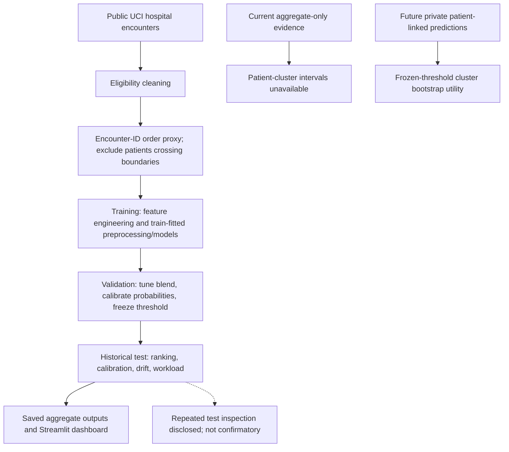
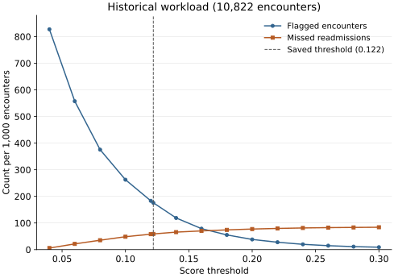

# Readmission Risk Audit

A Streamlit dashboard for auditing 30-day readmission models on the public UCI
diabetes hospital dataset. Compare model ranking, probability calibration,
threshold workload, missingness, and distribution shift, then inspect a saved
CatBoost ensemble on a single example encounter.

**Evaluation status:** all saved results are historical and retrospective.
Patients are separated across cohorts, but the test cohort was inspected across
multiple model and feature comparisons. It is not an untouched final benchmark.
This is an educational model audit, not a clinical decision system.

[Dashboard](https://yogesh-readmission-risk-audit.streamlit.app/) ·
[Evaluation and workload readout](outputs/evaluation_readout.md) ·
[Code walkthrough](WORKFLOW.md)

## Start here

- **Inspect the result:** [saved model comparison](outputs/model_comparison.csv),
  [calibration](outputs/calibration_curve.csv), and
  [cohort audit](outputs/leakage_audit.json).
- **Run a lightweight audit:** the [evaluation-only setup](#run) reads saved
  aggregates and runs uncertainty utility tests without downloading data or
  retraining a model.
- **Open the app locally:** the saved model files and dashboard outputs are
  checked in. The full environment is required, but retraining is optional.

## How the audit works

<details>
<summary>Editable workflow and code references</summary>



The diagram follows `clean_diabetes_data`, `make_patient_order_split`,
`prepare_model_features`, and `train_and_evaluate` in
[`readmission_audit/pipeline.py`](readmission_audit/pipeline.py).
[`app.py`](app.py) loads saved outputs and the two CatBoost models.
[`readmission_audit/evaluation.py`](readmission_audit/evaluation.py) provides
workload and patient-cluster uncertainty utilities. The future prediction path
is not evidence that historical patient-linked predictions are available.

</details>

## Decisions that matter

| Decision | Reason and tradeoff |
| --- | --- |
| Separate patients across train, validation, and test | Repeated visits must not place the same patient on both sides of an evaluation boundary. Excluding boundary-crossing patients also changes the evaluated population. |
| Use encounter ID as an ordering proxy | Row-level dates are unavailable. This tests transfer across an ordering boundary, not a calendar-time deployment. |
| Fit preprocessing on training data; calibrate and select thresholds on validation | Separates fitting and within-run selection. It does not undo later test inspection. |
| Keep the two-model CatBoost ensemble | The saved ensemble has the strongest historical PR-AUC and Brier score among the main comparison models. Larger experiments did not justify replacing it; this retention decision is exploratory. |
| Report PR-AUC, calibration, and workload together | With an 8.77% positive test rate, accuracy alone hides missed positives and false-positive burden. |

## Evidence and limits

The saved ensemble's historical test results are **ROC-AUC 0.6612**, **average
precision 0.1747** (named `pr_auc` in the code), and **Brier score 0.0773** on
**10,822 encounters**. At the validation-selected threshold of **0.122**, it flags
1,904 encounters, including 312 positives and 1,592 false positives. These are
retrospective audit counts, not a recommended clinical workload.

A base-rate probability has a Brier score of about 0.080 on this cohort, so the
probability-quality improvement is modest. Historical patient-cluster confidence
intervals cannot be recovered from aggregate scores; the repository does not
include the required encounter-level probabilities linked to patient IDs.
The [future evaluation protocol](config/evaluation_protocol.json) is an unfilled
draft, not an executed confirmatory study.

The machine-readable audit's `test_used_for_training_or_selection: false`
describes the training function's within-run selection path. It must be read
alongside the documented later test comparisons, not as proof that the entire
development history was blind to test results.

## Historical threshold workload



This plots the saved [aggregate readout](outputs/evaluation_readout.json), not new
predictions. The historical test was repeatedly inspected; these results do not
establish clinical utility. No patient-level records or invented intervals are used.

```sh
python -m pip install -r requirements-visuals.txt
python scripts/plot_historical_workload.py
python scripts/plot_historical_workload.py --check
```

## Dataset and target

- Source: [UCI Diabetes 130-US Hospitals for Years 1999-2008](https://archive.ics.uci.edu/dataset/296/diabetes-130-us-hospitals-for-years-1999-2008)
- Raw size: 101,766 encounters, 50 CSV columns
- UCI description: 47 predictive features from 130 US hospitals and delivery
  networks across 1999-2008
- Binary target: `1` when `readmitted == "<30"`; otherwise `0`
- License: CC BY 4.0; dataset DOI: `10.24432/C5230J`

The public file does **not** contain a row-level date or year. This project
therefore does not pretend that it can recover literal annual cohorts.

## Patient-disjoint evaluation and historical test reuse

The primary split is patient-disjoint and ordered by `encounter_id`:

1. use the lower 70% of encounter IDs as the training-order boundary;
2. use 70-85% as the validation-order interval;
3. use the upper 15% as the test-order interval;
4. exclude patients who cross a boundary.

This is an **encounter-order deployment proxy**, not a calendar-time split.
`patient_nbr` and `encounter_id` are used only to construct the split and are
removed from model features. Preprocessing is fit on train only, dropout and
threshold selection in the training code use validation only. However, the same
test partition has been inspected in multiple published comparisons, including
top-k features and later ensemble/architecture experiments. Some model-retention
explanations explicitly use those test comparisons. A within-run selection rule
does not establish that the entire development history was blind to test results.

Hospice and expired discharge dispositions are excluded because those
encounters are not eligible for subsequent readmission. Engineered features
include expanded ICD-9 families and three-digit codes, age midpoint,
medication-change counts, utilization and care-intensity ratios, and shifted
patient history. Patient-history fields use only strictly earlier encounters
under the encounter-ID ordering proxy; future rows and future labels are never
used.

## Models

### Logistic regression

A regularized linear probability baseline using the same train-fitted one-hot
preprocessing as the DNN.

### Histogram gradient boosting

A nonlinear tree-based baseline using train-fitted imputation and ordinal
categorical encoding.

### CatBoost

CatBoost retains native categorical columns. Eight completed validation-only
configurations established a depth-5 and depth-8 shortlist. The final models
use frozen tree counts, then a validation-only grid selects their convex blend:

```text
0.45 × depth-5 CatBoost + 0.55 × depth-8 CatBoost
  -> validation-only temperature scaling
  -> validation-only F1 threshold
```

The training functions select hyperparameters, blend weight, calibration and
threshold using validation inputs. This describes their within-run behavior;
it does not reverse the later exploratory inspection of test results.

### FT-Transformer

```text
numerical feature projections + categorical embeddings
  -> [CLS] + one token per engineered feature
  -> 3 pre-normalized Transformer blocks
  -> 8-head self-attention, ReGLU feed-forward layers
  -> LayerNorm + ReLU + Linear(2 raw logits)
```

- token dimension: `64`
- attention dropout sweep: `0.00`, `0.05`
- feed-forward dropout: `0.10`
- loss: `CrossEntropyLoss` on raw logits
- softmax: evaluation/inference only
- selection metric: validation PR-AUC
- calibration: validation-only temperature scaling

The improvement lab also trains one controlled denser candidate with
96-dimensional tokens, four blocks, eight heads, a 256-unit feed-forward layer,
and zero attention/feed-forward dropout. It is reported as an experiment rather
than silently replacing the better validated model.

### Shallow PyTorch DNN

```text
encoded input
  -> Linear(input_dim, 128)
  -> ReLU
  -> Dropout(p)
  -> Linear(128, 64)
  -> ReLU
  -> Dropout(p)
  -> Linear(64, 2 raw logits)
```

- loss: `CrossEntropyLoss` on raw logits
- softmax: evaluation/inference only
- dropout sweep: `0.00`, `0.05`, `0.10`, `0.15`
- selection metric: validation PR-AUC
- regularization: AdamW weight decay plus early stopping
- calibration: one temperature fit on validation logits only

## Evaluation

Every model is evaluated with ROC-AUC, PR-AUC, F1, recall, accuracy, Brier
score, log loss, 10-bin expected calibration error, and calibration curves.
The classification threshold is chosen on validation data to maximize F1 and
then frozen for test.

Distribution shift is measured from train to validation/test with:

- PSI and KS statistic for numeric features;
- Jensen-Shannon divergence for categorical features;
- validation-to-test changes in discrimination, threshold metrics, and
  calibration.

## Feature-selection audit

Feature ranking is performed before one-hot encoding and uses training data
only. Mutual information provides a common nonlinear score for numerical and
categorical/object features. Numeric fields also report absolute
point-biserial correlation; categorical fields report normalized mutual
information. Constants are forced to zero relevance.

The tuned CatBoost primary was compared with the top `15`, `25`, `35`, `50`,
and all `71` feature groups. Validation selected top 50 by ROC-AUC, after which
its blend weight, temperature, and threshold were fixed for that candidate's test
evaluation. The surrounding project had already inspected this test cohort.

| Feature groups | Validation ROC-AUC | Validation PR-AUC |
|---:|---:|---:|
| 15 | 0.6143 | 0.1391 |
| 25 | 0.6512 | 0.1595 |
| 35 | 0.6517 | 0.1649 |
| 50 | **0.6554** | 0.1697 |
| 71 | 0.6550 | **0.1705** |

The frozen top-50 model scored test ROC-AUC `0.6576` and PR-AUC `0.1695`,
below the saved demo ensemble's `0.6612` and `0.1747`. Therefore the
project keeps all 71 feature groups. This is a negative but useful result:
univariate top-k filtering did not improve this evaluation. Lost interaction
signal is a possible explanation, not a verified causal mechanism. The decision
to retain the full model after inspecting these test scores is exploratory.

## Missingness and statistical audit

All missingness and feature-quality decisions are computed from training data.
Exact raw missing rates are:

| Raw field | Missing | Decision |
|---|---:|---|
| `weight` | 96.86% | Exclude |
| `max_glu_serum` | 94.75% | Retain category + recorded indicator |
| `A1Cresult` | 83.28% | Retain category + recorded indicator |
| `medical_specialty` | 49.08% | Exclude |
| `payer_code` | 39.56% | Exclude |
| `race` | 2.23% | Retain explicit missing category |

The two lab-result fields are not treated as ordinary numerical missingness:
"not recorded" can describe care delivery, so the pipeline keeps the category
and adds `max_glu_serum_recorded` and `A1Cresult_recorded`.

Five medication fields are constant in training and six have fewer than 50
non-modal rows. Nevertheless, validation-only ablation selected all 73 current
engineered fields (PR-AUC `0.16919`) over dropping constants (`0.16555`),
dropping constants plus ultra-rare fields (`0.16764`), or also dropping sparse
lab results (`0.16787`). Sparse fields are therefore documented, not blindly
removed.

For categorical features, `outputs/categorical_chi_square_audit.csv` reports a
target-independence chi-square test, FDR-adjusted p-value, Cramer's V, minimum
expected count, and an assumption-validity flag. A uniform goodness-of-fit test
is included only as a requested diagnostic: clinical categories are not
expected to be uniform, so it cannot establish that the dataset is "neatly
spread" or non-random.

`outputs/autocorrelation_diagnostics.csv` reports ACF and cumulative Ljung-Box
statistics for the target and model residuals under encounter-ID order. The
source has no row-level dates, so these are ordering-proxy diagnostics rather
than time-series stationarity claims. At lag 20, target ACF was `0.0019`
(`p=0.4968`); the selected CatBoost residual ACF was `-0.00018` while the
cumulative lag-20 Ljung-Box test gave `p=0.0147`. The individual correlation
amplitude is tiny, while the omnibus residual result is surfaced rather than
over-interpreted.

## Improvement experiments (verified negative/marginal results)

Six CatBoost configurations were evaluated with three-fold
`StratifiedGroupKFold`, keeping patients disjoint. The best within-training
mean CV PR-AUC was `0.23774`, but its train-CV gap was `0.09703` and transfer to
the later encounter-order validation cohort was much weaker. A separate later
validation gate therefore selected the final pair before test evaluation.

| Candidate | Test ROC-AUC | Test PR-AUC | F1 | Recall | Brier |
|---|---:|---:|---:|---:|---:|
| Existing CatBoost ensemble | 0.66124 | 0.17465 | **0.21872** | 0.32877 | 0.07731 |
| Later-validation-gated CatBoost pair | **0.66344** | 0.17386 | 0.21462 | 0.29399 | 0.07734 |
| Existing + new CatBoost blend | 0.66189 | **0.17469** | 0.21771 | **0.36143** | **0.07729** |

The larger blend's PR-AUC gain is only `0.000036` while F1 and accuracy fall.
The existing ensemble remains the primary saved demo model because the marginal
change does not justify a more complex four-model inference path.

The denser zero-dropout FT-Transformer stopped at epoch 2. It reached test
ROC-AUC `0.65271` and PR-AUC `0.15575`: better ROC-AUC than the prior FT model,
but worse PR-AUC and still below CatBoost. The best autoencoder experiment used
a 64-dimensional bottleneck plus histogram gradient boosting and reached only
test ROC-AUC `0.62822` and PR-AUC `0.13398`. The autoencoder removed predictive
signal rather than useful fluff, so it is not used in the final model.

### Final rescue pass: XGBoost, TabM, and stacking

XGBoost was added because a recent study on this same public cohort reported it
as the strongest of logistic regression, random forest, XGBoost, and DNN
baselines. TabM was added as a modern parameter-efficient ensemble of MLPs. Six
XGBoost candidates and one early-stopped TabM-mini candidate were selected on
the later validation cohort; their weights were fixed before their test scoring.
The test cohort itself was already known from earlier experiments.

| Model | Validation PR-AUC | Test ROC-AUC | Test PR-AUC | Test F1 | Test Brier |
|---|---:|---:|---:|---:|---:|
| Existing CatBoost ensemble | 0.17076 | **0.66124** | **0.17465** | **0.21872** | **0.07731** |
| XGBoost | 0.17292 | 0.63771 | 0.15605 | 0.19641 | 0.07832 |
| TabM-mini | 0.16402 | 0.64018 | 0.15498 | 0.20031 | 0.07858 |
| CatBoost + XGBoost + TabM | **0.17628** | 0.65118 | 0.16529 | 0.20082 | 0.07779 |

The rescue models improved validation ranking but did not transfer to the later
encounter-order test cohort. Retuning against test would be leakage. The
existing CatBoost therefore remains primary. Further material improvement now
requires richer predictors—such as real dates, laboratory values, vital signs,
comorbidity detail, hospital/provider context, and behavioral or social-risk
variables—not another larger architecture over the same inputs.

## Verified historical local results

The checked-in values below are refreshed only after a successful full training
run. Machine-readable proof is in `outputs/metrics.json`,
`outputs/model_comparison.csv`, `outputs/performance_drift.csv`, and
`outputs/leakage_audit.json`.

<!-- VERIFIED_RESULTS_START -->
Verified locally on 2026-08-24 with seed 42:

```text
raw encounters:                 101,766
eligible after hospice/death:    99,343
modeling rows after boundaries:  83,621
train / validation / test:       63,512 / 9,287 / 10,822
patient overlap across splits:   0
primary-model engineered features: 71
improvement-lab feature groups:     73
encoded DNN input features:        839
FT feature tokens:                  71 + CLS
selected DNN dropout:              0.05
selected FT attention dropout:     0.05
CatBoost blend:                    0.45 / 0.55
CatBoost temperature:              0.8863
```

Historical patient-disjoint test results; each reported threshold was selected on validation data:

| Model | ROC-AUC | PR-AUC | F1 | Recall | Accuracy | Brier | ECE |
|---|---:|---:|---:|---:|---:|---:|---:|
| Logistic regression | 0.6205 | 0.1445 | 0.1953 | 0.3045 | 0.7800 | 0.0793 | 0.0147 |
| HistGradientBoosting | 0.6268 | 0.1438 | 0.2019 | **0.3772** | 0.7385 | 0.0791 | 0.0145 |
| CatBoost tuned primary | 0.6603 | 0.1724 | **0.2202** | 0.3678 | 0.7716 | 0.0777 | 0.0161 |
| CatBoost tuned ensemble, temperature-scaled | **0.6612** | **0.1747** | 0.2187 | 0.3288 | 0.7940 | **0.0773** | **0.0088** |
| DNN, temperature-scaled | 0.6316 | 0.1481 | 0.1964 | 0.2719 | 0.8049 | 0.0788 | 0.0187 |
| FT-Transformer, temperature-scaled | 0.6463 | 0.1594 | 0.2033 | 0.2877 | **0.8023** | 0.0780 | 0.0135 |

The tuned CatBoost ensemble improved the previous best held-out ROC-AUC from
0.6406 to 0.6612 and the previous best PR-AUC from 0.1519 to 0.1747. The tuned
primary CatBoost had the highest thresholded F1, while HistGradientBoosting had
the highest recall at its separately validation-selected threshold. Accuracy is
not treated as the primary result because the positive test rate is 8.77%.

Feature engineering also improved FT-Transformer test ROC-AUC from 0.6345 to
0.6463 and PR-AUC from 0.1481 to 0.1594, but FT still did not beat CatBoost and
was substantially more expensive to train. Five-percent attention dropout won
the refreshed validation sweep (PR-AUC 0.1597 versus 0.1561 at zero dropout).

From validation to the later encounter-order test cohort, calibrated CatBoost
ROC-AUC increased by 0.0051 and PR-AUC by 0.0039; F1 fell by 0.0084, recall fell
by 0.0506, and Brier worsened by 0.0041. The engineered
`prior_mean_number_diagnoses` had the largest train-to-test shift (PSI 0.5174),
which is surfaced in the drift view rather than hidden.
<!-- VERIFIED_RESULTS_END -->

## Run

### Read uncertainty status and workload without training

```powershell
python -m venv .venv-evaluation
.\.venv-evaluation\Scripts\python.exe -m pip install -r requirements-evaluation.txt
.\.venv-evaluation\Scripts\python.exe scripts\evaluation_readout.py
.\.venv-evaluation\Scripts\python.exe -m unittest discover -s tests -p test_evaluation.py -v
```

[config/evaluation_protocol.json](config/evaluation_protocol.json) is a future protocol draft, not an executed or approved study. Its cohort, artifact hashes and locked threshold are deliberately unfilled. A newly designated unseen cohort is needed for a confirmatory result; the reused test cannot be relabeled untouched.

**Historical confidence intervals are unavailable:** the tracked repository contains aggregate scores but no encounter-level probabilities linked to patient IDs. ROC-AUC, average precision and patient-cluster uncertainty cannot be reconstructed from confusion counts. The new [utility](readmission_audit/evaluation.py) accepts real prediction rows, resamples entire patients, keeps the threshold fixed, and reports dropped/missing and single-class replicate counts. It does not refit or repair selection bias.

For an existing private prediction export:

```powershell
.\.venv-evaluation\Scripts\python.exe scripts\evaluation_readout.py --predictions data\private\historical_test_predictions.csv
```

Required columns are `encounter_id,patient_id,y_true,y_prob`; patient IDs may repeat, encounter IDs must not. Missing values raise by default. `--missing-policy drop` explicitly reports exclusions. The default threshold comes from the saved CatBoost config, not a search over test outcomes. A full future training run can optionally create the ignored private export using `scripts/build_readmission_audit.py --export-private-predictions`; this repair did not run that training or create real patient-linked predictions.

The [historical workload table](outputs/historical_threshold_workload.csv) adds the exact saved threshold `0.122` to the existing sensitivity grid. It flags 1,904/10,822 encounters (175.94 per 1,000), captures 312/949 positives (32.88% recall), and has 1,592 false positives. These are retrospective audit counts, not a recommended clinical workload. Choose any new threshold on validation under a declared workload objective.

### Open the saved dashboard

```powershell
$ReadmissionVenv = "$env:USERPROFILE\Documents\Codex\.venvs\readmission-risk"
python -m venv $ReadmissionVenv
& "$ReadmissionVenv\Scripts\python.exe" -m pip install -r requirements.txt
& "$ReadmissionVenv\Scripts\python.exe" -m streamlit run app.py
```

The short environment path avoids Windows' legacy path-length limit when
installing PyTorch from this deeply nested project directory.

The environment path is a local choice; change it if needed. Dependency ranges
are specified in `requirements.txt`, so this is not a fully locked environment.
The checked-in outputs support dashboard review without a training run.

### Rebuild models and experiment outputs (optional)

The following commands download the public dataset when it is absent and run
model training. They are substantially heavier than reviewing the saved audit;
run them only when you intend to regenerate artifacts.

```powershell
& "$ReadmissionVenv\Scripts\python.exe" scripts\build_readmission_audit.py
& "$ReadmissionVenv\Scripts\python.exe" -m scripts.run_improvement_experiments
& "$ReadmissionVenv\Scripts\python.exe" -m scripts.finalize_catboost_improvement
& "$ReadmissionVenv\Scripts\python.exe" -m scripts.run_xgb_tabm_stack
```

## Test

```powershell
& "$ReadmissionVenv\Scripts\python.exe" -m unittest discover -s tests -v
```

## Generated artifacts

```text
artifacts/
  dnn_state.pt
  ft_transformer_state.pt
  ft_preprocessor.joblib
  ft_transformer_config.json
  catboost_model.cbm
  catboost_secondary_model.cbm
  catboost_config.json
  preprocessor.joblib
  logistic_model.joblib
  tree_model.joblib
  model_config.json
  ft_dense_zero_dropout_state.pt
  ft_dense_zero_dropout_config.json
  autoencoder_state.pt
  autoencoder_config.json
  catboost_later_gated_primary.cbm
  catboost_later_gated_secondary.cbm
  catboost_later_gated_config.json
  xgboost_model.json
  xgboost_preprocessor.joblib
  tabm_state.pt
  tabm_preprocessor.joblib
  xgboost_tabm_stack_config.json
outputs/
  metrics.json
  model_comparison.csv
  dropout_sweep.csv
  ft_attention_dropout_sweep.csv
  ft_train_history.csv
  catboost_blend_sweep.csv
  catboost_hyperparameter_search.csv
  hgb_hyperparameter_search.csv
  calibration_curve.csv
  feature_drift.csv
  feature_relevance.csv
  top_k_feature_ablation.csv
  top_k_final_comparison.csv
  performance_drift.csv
  leakage_audit.json
  raw_missingness_audit.csv
  feature_quality_audit.csv
  categorical_chi_square_audit.csv
  autocorrelation_diagnostics.csv
  feature_pruning_ablation.csv
  catboost_group_grid_search.csv
  catboost_later_validation_gate.csv
  catboost_final_improvement_comparison.csv
  ft_dense_zero_dropout_history.csv
  autoencoder_history.csv
  autoencoder_comparison.csv
  xgboost_validation_search.csv
  tabm_history.csv
  catboost_xgboost_tabm_stack_sweep.csv
  xgboost_tabm_stack_comparison.csv
```

## Responsible use

The output is not a diagnosis, treatment recommendation, or validated hospital
workflow. The dataset is historical and sensitive, hospital identifiers and
timestamps are unavailable, and performance on this public benchmark does not
establish present-day clinical validity.

## Uncertainty method references

- [scikit-learn average precision](https://scikit-learn.org/stable/modules/generated/sklearn.metrics.average_precision_score.html): the project's `pr_auc` calculation uses average precision, not trapezoidal PR area.
- [SciPy bootstrap documentation](https://docs.scipy.org/doc/scipy/reference/generated/scipy.stats.bootstrap.html): background on resampling and percentile intervals. This repository explicitly samples whole patient clusters rather than applying an independent-row bootstrap.
