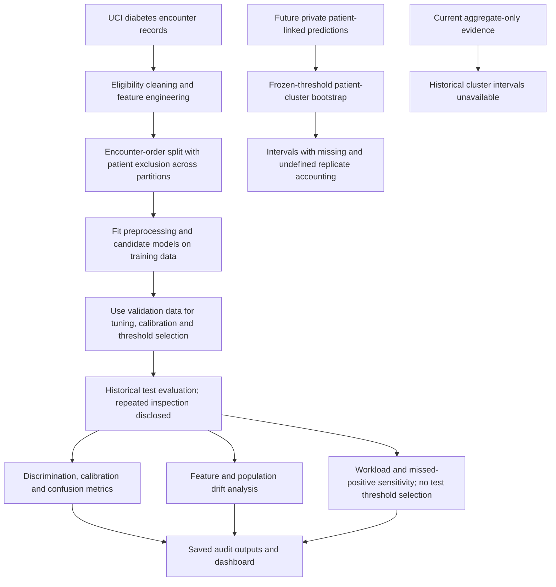

# Readmission Risk Audit: workflow

Study readmission prediction with patient separation, model comparisons, calibration and threshold analysis. The project is a retrospective audit, not a clinical decision system.

**Relevant roles:** data science, ML engineering.

## Flowchart

## Explain it in an interview

“I focus on leakage and calibration as well as ranking performance. I can trace how the cohort changes, why patients cannot appear across partitions, and how a threshold affects false positives and missed readmissions.”

## What this diagram does and does not establish

Encounter ID is an ordering proxy, not a calendar timestamp. Patient exclusion changes the modeling population. Saved results are historical artifacts; this diagram does not assert that every historical experiment preserved a never-inspected final test set. Clinical deployment would need external validation and operational review.

## Follow the code

- [Cleaning, splitting, modeling and evaluation](readmission_audit/pipeline.py)
- [Experiment support](readmission_audit/experiments.py)
- [Saved metrics](outputs/metrics.json)
- [Future evaluation protocol draft](config/evaluation_protocol.json)
- [Cluster-bootstrap and workload utility](readmission_audit/evaluation.py)
- [Historical workload and uncertainty status](outputs/evaluation_readout.md)
